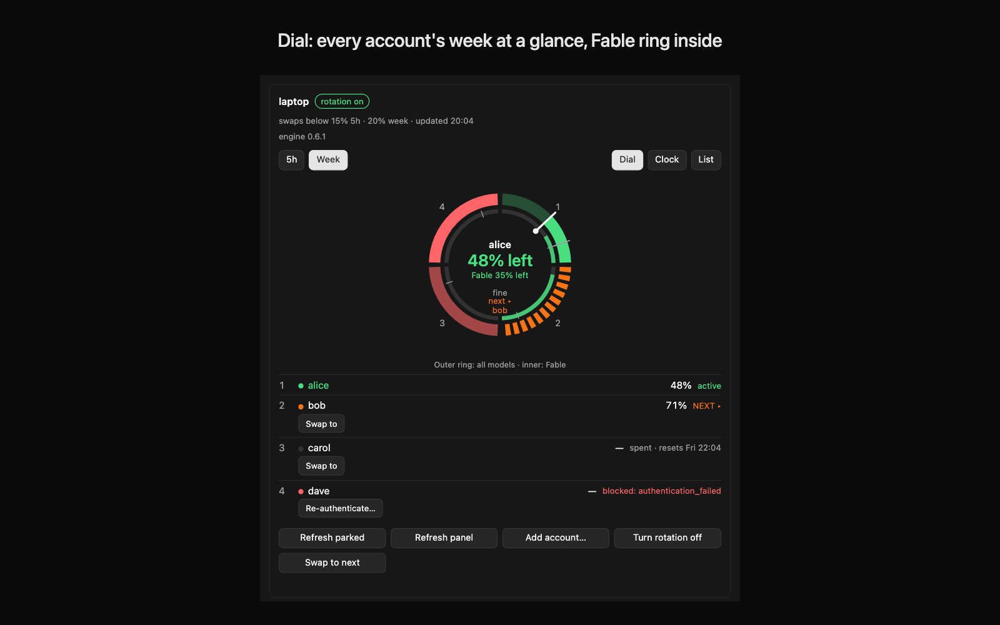
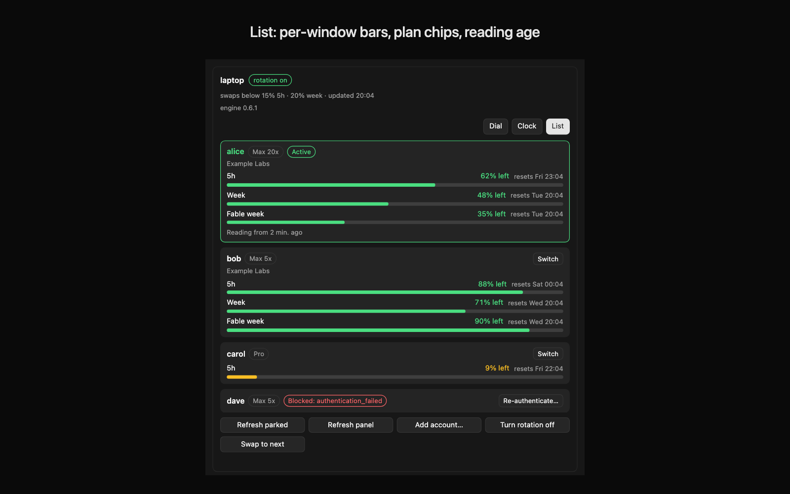
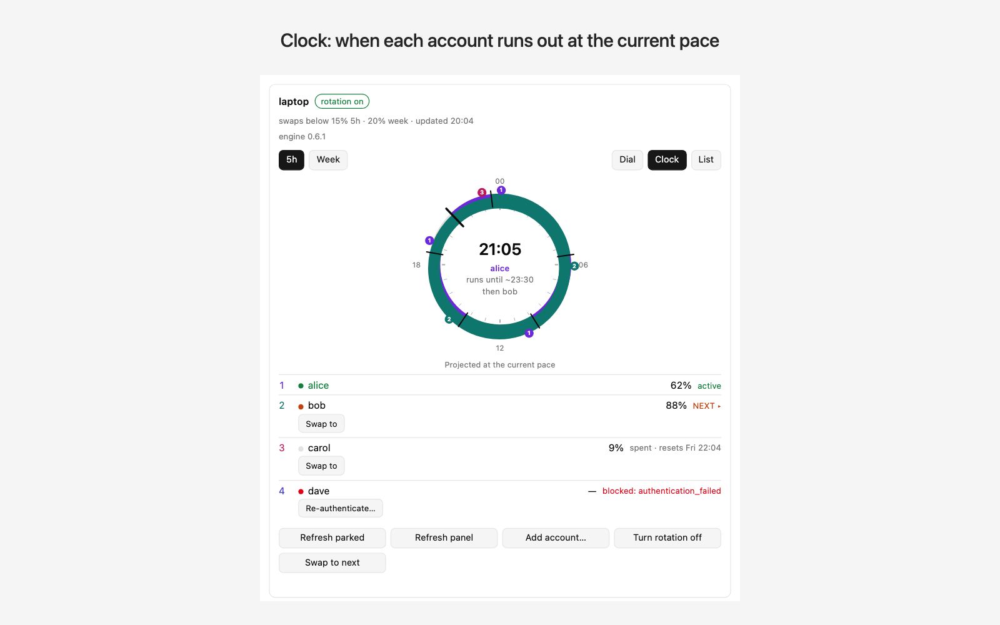

# Grazr for Orca

Grazr rotates the **System default** Claude Code account on each of your hosts before a usage window runs out. It uses the grazr engine, a small Python program that runs on each host, so you keep working in the same conversation when a swap happens. Orca is the front end: a command palette, OS notifications, and a **Claude Accounts** panel in the right sidebar that shows every host in one place.

Hosts are this Mac plus any remote machines you reach over `ssh`. Orca's own managed accounts are left alone.

## Screenshots

<!-- Screenshots of the panel. Replace the placeholders when the images are added. -->

| Dial (dark) | List (dark) | Clock (light) |
|---|---|---|
|  |  |  |

The panel has three faces. **Dial** shows a ring with one segment per account, in rotation order. **Clock** shows a 24-hour face (5h view) or a 7-day face (Week view), with the swaps and refills projected ahead. **List** shows one card per account with a bar for each usage window.

## Requirements

- Orca 1.4.245 or later, with the plugin system enabled.
- Python 3 (`python3`) on this Mac and on each remote host.
- Claude Code on each host that signs accounts in, at its `claudeBin` (default `~/.local/bin/claude`).
- For sign-in: the `orca` CLI on this Mac (`orcaBin`, default `/usr/local/bin/orca`), a local Orca project on this Mac whose worktree hosts the sign-in tab (`signinWorkspace`), `claude` on the login host, and on that host plain `ssh`, `setsid` and GNU `timeout`. See [Enrolling accounts](#enrolling-accounts).
- `ssh` access to each remote host in batch mode, with keys or Tailscale SSH.
- `rsync` on this Mac and on each remote host. `Install engine` copies the engine with it.

## Install

Once the plugin is listed in Orca's plugin catalog, install it from there.

Until then, in Orca open **Settings › Plugins**, turn the plugin system on, and install from the git URL:

```
https://github.com/senadaruc/orca-grazr
```

An installed copy shows the committed placeholder panel. To see live data in the panel, run a development install from a checkout, as described under [Development](#development).

## First steps

1. **Add your hosts.** The shipped default manages only this Mac. To add a remote host, edit the plugin's `settings.json` (see [Settings](#settings) and [Remote hosts](#remote-hosts)). The file lives at `<userData>/plugins-data/senadaruc.grazr/settings.json`.
2. **Install the engine on the target host.** Press Cmd-J and run `Grazr: Install engine on target`. Use `Grazr: Target → next host` to move the target to another host first.
3. **Enrol accounts.** Open the Claude Accounts panel and press `Add account…`, which signs in through a local Orca workspace's built-in browser. Sign-in needs a remote host to log in on and a local Orca project on this Mac for the browser tab, and the default settings manage only this Mac, so add a remote host first (see [Remote hosts](#remote-hosts)). Then add the account names to the host's `config.env`, as described under [Enrolling accounts](#enrolling-accounts). Repeat for each host.
4. **Open the panel.** Run `Grazr: Refresh panel`, then open the right sidebar and choose **Claude Accounts**.

If another grazr already owns Claude's status line on the Mac, read [Status line owned by another grazr](#status-line-owned-by-another-grazr) before step 2.

## How the panel buttons behave

The panel runs each button through the Orca host. How the button completes depends on the Orca you run. The direct buttons, the sign-in, and the panel following the focused workspace all need an Orca with the `commands.execute` host method, proposed upstream in [stablyai/orca#36400](https://github.com/stablyai/orca/pull/36400). On current Orca, which does not offer that method yet, the buttons show the command and the tabs work, but the panel does not follow the focused workspace.

- **On an Orca that offers the `commands.execute` host method**, the buttons run directly. Refresh, Swap and Turn rotation on or off run without typing anything, and the result shows on the card's message line. `Add account…` and `Re-authenticate…` open Claude's login in a local Orca workspace's built-in browser, and the account is enrolled on the card's host once the login succeeds (see [Enrolling accounts](#enrolling-accounts)). The panel also follows the focused workspace's host (see [Claude Accounts panel](#claude-accounts-panel)).
This release does not request `commands:execute`. The panel tries the method first and, when the host refuses it, falls back to typing as described next.
- **On current Orca**, the buttons type the command into the most recently opened terminal of the focused worktree. They do not press Return: read the command and press Return yourself. If the newest terminal is an agent pane, open a new shell terminal first. The line under each card says where the text went, or asks you to open a shell terminal in a worktree first. On this kind of Orca, `Add account…` and `Re-authenticate…` do not start a sign-in: the card shows the enrol command under its message line instead, to run in a shell terminal.

The palette commands always work, on either Orca. From the palette, `Grazr: Type enrol command into terminal` and `Grazr: Type status command into terminal` type into the newest terminal of the focused worktree.

## Settings

Orca keeps the settings in `<userData>/plugins-data/senadaruc.grazr/settings.json`. On first activation the plugin writes only the default keys that are missing; values you set are kept. Edit the file to change them. Changes to `drainIntervalMs` and the hosts take effect on the next drain tick, without a restart.

- `hosts`: the hosts to manage. See [Remote hosts](#remote-hosts) for the fields.
- `target`: the host that target-scoped commands act on. It must match a host `name`. The default is `mac`.
- `engineDir`: where the engine is installed on each host. The default is `~/.local/share/orca-grazr/engine`.
- `stateDir`: where the engine keeps its state, passed to it as `GRAZR_STATE_DIR`. The default is `~/.local/state/orca-grazr`.
- `configDir`: where the engine reads its `config.env`, passed as `GRAZR_CONFIG_DIR`. The default is `~/.config/orca-grazr`.
- `drainIntervalMs`: how often the plugin drains the engine's notices. It is also the base for backoff after a failed drain. It is clamped to 30 seconds through 4 minutes, because Orca reaps an idle worker after five minutes.
- `drainEnabled`: whether the drain loop runs. Agent and worktree events respect it too, so `false` keeps the loop stopped.
- `maxToastsPerHostPerCycle`: how many notices one host can show per drain. Extra notices collapse into one `+N more notices` toast.
- `forceInstall`: whether `Install engine` takes over a status line that another grazr owns. It is the default for every host; a host can override it with its own `forceInstall`.
- `panelFace`: the face every card opens with: `clock`, `dial` or `list`. The default is `clock`.
- `panelView`: the window every card opens with: `session` (5h) or `weekly` (Week). The default is `session`.
- `orcaBin`: the Orca CLI that opens each sign-in tab in a local Orca workspace. The default is `/usr/local/bin/orca`. A value that is blank or starts with `-` falls back to the default.
- `signinWorkspace`: optional. The local Orca worktree the sign-in tab opens in, as an `id:<worktree id>` or `path:<folder>` selector. When it is unset, the first local worktree is used, and the plugin's own folder when it is one.
- `signinHost`: optional. The name of a configured remote host. A sign-in for a card on this Mac logs in on it. When it is unset, the first remote host is used.
- `orcaProfileDb`: the Orca profile database the panel reads to find the host of the focused workspace. It is opened read-only. The default is `~/Library/Application Support/orca/profiles/local-default/profile-state.db`. A value that is blank or starts with `-` falls back to the default.
- `sqliteBin`: the `sqlite3` that reads that database. The default is `/usr/bin/sqlite3`. A value that is blank or starts with `-` falls back to the default.
- `sshBin`, `rsyncBin`: the `ssh` and `rsync` binaries to run.
- `sshOptions`: the options passed to every `ssh` call. The defaults are `BatchMode=yes` and a 5 second connect timeout.

## Remote hosts

Add a remote host to `hosts` in `settings.json`. Each host has these fields:

- `name`: the label used in toasts and by `target`.
- `ssh`: the `ssh` host alias, or `null` for this Mac. The alias must work non-interactively (`BatchMode`), so set up keys first.
- `python`: the Python 3 interpreter on that host. The default is `python3`.
- `claudeBin`: optional. The Claude Code binary on that host, run for a sign-in over `ssh`. The default is `~/.local/bin/claude`. A value that is blank or starts with `-` falls back to the default.
- `orcaEnvironment`: optional. The name of the Orca environment this host is paired as. The panel matches a workspace on that environment to this host. The default is the host's `name` for an ssh host, and none for this Mac. A value that starts with `-` is ignored.
- `notifier`: how the engine reports notices. This Mac uses `osascript`, so the engine posts macOS notifications directly. Remote hosts use `queue`, and the plugin drains and shows those notices.
- `forceInstall`: optional, `true` or `false`. It overrides the global `forceInstall` for this host only. Leave it out to follow the global value.

For example, a remote box named `devbox`, reached through the `ssh` alias of the same name:

```json
{ "name": "devbox", "ssh": "devbox", "python": "python3", "notifier": "queue" }
```

A host list that includes the Mac must keep the Mac's entry with `"ssh": null` and `"notifier": "osascript"`. A comma list in `notifier` fans out to each channel, so `queue,osascript` on the Mac would show each notice twice.

## Enrolling accounts

`Add account…` and `Re-authenticate…` on a panel card sign in through Orca's built-in browser and enrol the account on that card's host. Nothing opens in your system browser.

How a sign-in works:

- The login runs on one of your ssh hosts, in a throwaway directory there, over plain `ssh` with its stdin kept open (no pty). A card on a remote host logs in on that host. A card on this Mac logs in on `signinHost`, or on the first remote host. Without a remote host to log in on, the sign-in is refused at once.
- The sign-in tab opens in a local Orca workspace on this Mac (`signinWorkspace`, or the first local worktree), in Orca's built-in browser, in an isolated browser profile, and is brought to the front. The start message names that workspace. A re-authentication reuses the account's profile, `grazr · <account>`. An add-account sign-in gets a fresh profile, `grazr · new account <yyyy-mm-dd hh:mm>`, which is deleted when the sign-in ends, whatever the outcome.
- Approving in the tab sends the code back to the login by itself: the plugin reads the tab's address, and when it is Claude's code callback for this sign-in (matched by its state), it writes the code into the login's stdin, once. Nothing is copied by hand, and the code is never logged or shown.
- A sign-in that is steered off the authorize flow is returned to it, at most five times.
- Only an https address on claude.ai, claude.com or anthropic.com is opened. Anything else is refused and nothing is opened.
- The enrolment reads the login on the remote host. The account may be enrolled on a different host than the one that logged in. This Mac receives the account's export only on the stdin of its engine, never in an argument, and the login is discarded afterwards on the remote host.
- A sign-in gets 30 minutes. The remote command runs under `timeout -k 5 1830`, so a sign-in that never finishes stops on the remote host too. Cancelling, failing or timing out stops the login's whole process group there, because Claude ignores TERM and a dropped connection does not reach it. The `timeout` and `setsid` commands must exist on that host.
- A second sign-in for the same card cancels the running one: its login is stopped, discarded and its tab closed, and then the new sign-in starts. The exception is a second click for the same account while its tab is still open, which only switches to that tab.

To enrol from the terminal instead:

1. Open a new shell terminal in a worktree, then run `Grazr: Type enrol command into terminal` from the palette. The command goes to the most recently opened terminal, so open a fresh shell first.
2. Press Return in that terminal.
3. Press `s` to save the account you are logged in to now, or `l` to log in to another account. After `l`, enter a name for the account when asked. To re-authenticate an enrolled account, enter the name it already has.
4. List the accounts in the host's `~/.config/orca-grazr/config.env`:

   ```
   ACCOUNTS="work personal"
   ```

   You can also set it from the shell:

   ```
   GRAZR_STATE_DIR=~/.local/state/orca-grazr GRAZR_CONFIG_DIR=~/.config/orca-grazr python3 ~/.local/share/orca-grazr/engine/grazr.py set ACCOUNTS "work personal"
   ```

   On a remote host, prefix the command with `ssh <host> '…'`, or run it on that host.

5. Repeat for each host.

## Status line owned by another grazr

If another grazr, such as the one in the Herdr terminal app, already owns Claude's status line on a host, `Install engine` refuses and the toast names the state directory. Two ways out:

- **Take the host over.** Set `forceInstall: true` on that host only, as in [Remote hosts](#remote-hosts). Leave the other hosts on the global default.
- **Hand the status line over.** On a Mac, first disconnect the other grazr from the status line, restart Orca or open a Claude pane so Orca fills the empty status line slot, and then run `Grazr: Install engine on target`. Orca only fills an empty slot; in the reverse order, Orca has no status line.

A status bar of your own that calls grazr is never taken over, forced or not. Edit that bar by hand.

## Commands

These commands appear in the Orca command palette.

- `Grazr: Target → next host`: moves the target to the next host in the list.
- `Grazr: Status (all hosts)`: shows each host's accounts and usage, one toast per host.
- `Grazr: Swap now (target)`: swaps the target host to its next account now.
- `Grazr: Refresh parked accounts (target)`: refreshes every account on the target host, including the active one. It asks Claude's usage endpoint and refreshes any lapsed token.
- `Grazr: Toggle rotation (target)`: turns automatic rotation on or off on the target host.
- `Grazr: Install engine on target`: copies the engine to the target and installs grazr's status line and failure hook.
- `Grazr: Uninstall from target`: removes grazr's status line and failure hook from the target.
- `Grazr: Drain notices now`: delivers the queued notices immediately.
- `Grazr: Type enrol command into terminal`: types the enrol command into the newest terminal of the focused worktree. It does not press Return.
- `Grazr: Type status command into terminal`: types the status command into the newest terminal of the focused worktree. It does not press Return.
- `Grazr: Show the focused workspace's host`: toasts the host the focused workspace belongs to. The panel asks for the same answer itself and does not toast.
- `Grazr: Refresh panel`: regenerates the Claude Accounts panel from a fresh status run on every host, and reports whether the page changed.

## Claude Accounts panel

The panel shows every managed host. A tab strip across the top has one tab per host, each with a status dot: green when rotation is on and the host is reachable, grey when rotation is off, red when the host is unreachable or has no engine. One host's card shows at a time. Click a tab to read another host, or use Left and Right (Home and End) to move between tabs. The strip scrolls sideways when there are more hosts than fit.

The tab of the host the focused workspace is on is selected first, and the panel follows the focused workspace while it is visible: a local workspace selects this Mac's tab, and a workspace on a paired environment selects that host's tab. The selected tab follows a change of workspace within about four seconds. The panel reads the focused workspace's host from Orca's profile database, read-only, and maps a paired environment to its host through `orca environment list --json` (cached for 60 seconds). Only a change of host moves the selection, so a tab you pick by hand stays selected until you switch workspace. If the Orca CLI or the database cannot be read, the panel keeps the cards as they are and tries again.

Each card, under its tab, shows:

- A header line with the swap thresholds the engine reports for that host, the time the host's data last changed, and a chip for the host's state: `rotation on`, `rotation off`, `not connected`, `unreachable`, `engine not installed`, `managed profile`, `engine update available` or `another grazr owns the status line`. `not connected` means the status line or the stop hook is missing on that host, so nothing rotates there.
- An `engine <version>` line. When the installed engine differs from the one the plugin bundles, `engine update available` appears. Run `Grazr: Install engine on target` to update it.
- A 5h view and a Week view, switched with the buttons at the top of the card. Each view has a ring with one numbered segment per account, in rotation order. A needle marks the share used on the active account's segment, and a tick marks the swap threshold. When the engine watches per-model limits (`MODEL_LIMITS=1` in that host's `config.env`), the Week view adds an inner ring per model. An account that has a weekly reading but no 5-hour window (some plans have no 5-hour limit) reads `no 5-hour limit` on the 5h view, muted and never counted as spent, and a host where no account has a 5-hour window opens on Week whatever `panelView` says.
- A `Dial | Clock | List` switch. Hovering a segment shows its account, the percentage left, the swap threshold and the reset time.
- Colours by account state: red for an account that is spent or blocked, green at reduced opacity for a parked account that still has tokens, grey for an unknown or unenrolled account, and orange and dashed for the next account.
- One row per account, with its percentage and status: `active`, `NEXT ▸`, `spent · resets <day and time>`, `blocked: <reason>`, `not read yet` or `not enrolled`.

The next account is the first account in rotation order, other than the active one, that is parked, not blocked, and has no live window below its threshold. This is the engine's rule, so `NEXT ▸` names the account that a swap moves to.

### Clock

The Clock face shows a 24-hour face on the 5h view and a 7-day face on the Week view. The hand sits at now. The ring ahead of the hand is coloured by the account grazr is projected to be on, and red where nothing can run. A swap is a tick across the ring, and a refill is a numbered dot outside it. The projection uses the engine's pace figures, so the host needs engine `0.4.7+fork.7` or later.

### List

The List face shows one card per account, with a bar for each usage window: 5h, Week, and each per-model week when model limits are on. A bar is green when fine, amber below the swap threshold, and red at 2% or less. A window whose reset has passed reads `reset since`. The card also carries the Active and Blocked chips, the organisation, and the Switch and Re-authenticate… buttons.

### When the panel updates

The worker regenerates the panel when the plugin activates, after each drain tick while the drain loop runs, and after target next, status, swap, refresh, toggle rotation, install and uninstall. The page is rewritten only when something on it changed. The `5h | Week` and `Dial | Clock | List` toggles switch every card until the page is next rewritten.

A host that times out under a short command budget keeps its last reading. A host that times out at the full ten seconds is shown as `unreachable`.

## Notifications

On this Mac the engine posts its notices as macOS notifications directly. Each remote host whose `notifier` includes `queue` queues its notices, and the plugin drains those queues every `drainIntervalMs` and shows each one as an OS notification. A host without the engine installed is logged and retried quietly, with backoff capped at 10 minutes. An unreachable host is reported once, then retried with backoff; its later failures do not toast again until it recovers.

## Limits

- Pinning an agent to its own account is not supported yet.
- The plugin does not sync accounts between machines. That would move OAuth tokens between machines, which is a separate project.
- There are no keyboard shortcuts for the commands.
- Plugins run on the desktop only.

## Credits and license

Grazr for Orca is MIT licensed; see [LICENSE](LICENSE).

The rotation engine in `engine/` is derived from [wazum/herdr-grazr](https://github.com/wazum/herdr-grazr) by Wolfgang Klinger (MIT). The copy here is a fork maintained with the plugin; see [engine/VENDORED.md](engine/VENDORED.md) for the source commit and how to refresh it.

## Development

Run the tests from the repository root. The suite uses Node's built-in test runner:

```
npm test
```

To run the plugin from a checkout with live panel data, add the folder in Orca under **Settings › Plugins › Development folders**. A development folder overrides an installed copy with the same id. Orca then writes `panel/accounts.html` in the folder. The file embeds your host names and account names, so keep it out of commits:

```sh
git update-index --skip-worktree panel/accounts.html
```

Run `git update-index --no-skip-worktree panel/accounts.html` to undo it. To regenerate the committed placeholder after changing the panel template, run `npm run placeholder`.

Editing `main.mjs` or anything under `lib/` does not restart the running worker. Use **Restart** on the plugin row, or disable and re-enable the plugin, to load your changes.
